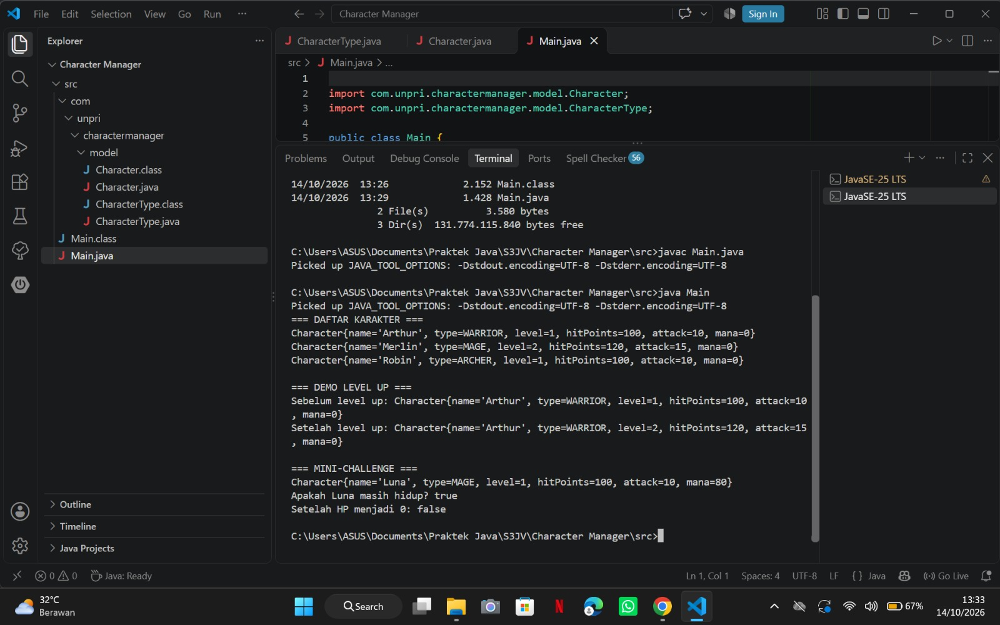

# Character Manager — TP3 (Java Visual SIH-6406)

## Deskripsi

Character Manager merupakan project Java yang menerapkan konsep Object-Oriented Programming (OOP) untuk mengelola karakter. Project ini menggunakan class, constructor, enum, encapsulation, getter/setter, serta method level-up dan pemeriksaan status hidup karakter.

## Fitur

- Empat konstanta pada enum `CharacterType`.
- Dua constructor pada class `Character`.
- Atribut private dengan getter dan setter.
- Validasi nilai mana agar tidak negatif.
- Method `isAlive()` untuk memeriksa HP karakter.
- Method `toString()` untuk menampilkan informasi karakter.
- Demo level-up untuk memperbarui HP dan attack.

## Screenshot Output



## Struktur Folder

```text
javavisual-tp03-[NIM]/
├── CharacterManager/
│   └── src/
│       └── com/
│           └── unpri/
│               └── charactermanager/
│                   ├── Main.java
│                   └── model/
│                       ├── Character.java
│                       └── CharacterType.java
├── screenshots/
│   └── output.png
└── README.md
```

## Identitas Mahasiswa

- Nama : Alivia Neisya Putri Prastomo
- NIM: 253303621232
- Kelas: 3 Pagi A
- Mata kuliah: TP3 Java Visual

## Analisis Desain

Dokumen Google Docs: [https://docs.google.com/document/d/1X5asCRKDDv6MMs_Wa7JOvjmzOfItPiiOEJAsP3r9Xgc/edit?usp=sharing](https://docs.google.com/document/d/1X5asCRKDDv6MMs_Wa7JOvjmzOfItPiiOEJAsP3r9Xgc/edit?usp=sharing)


