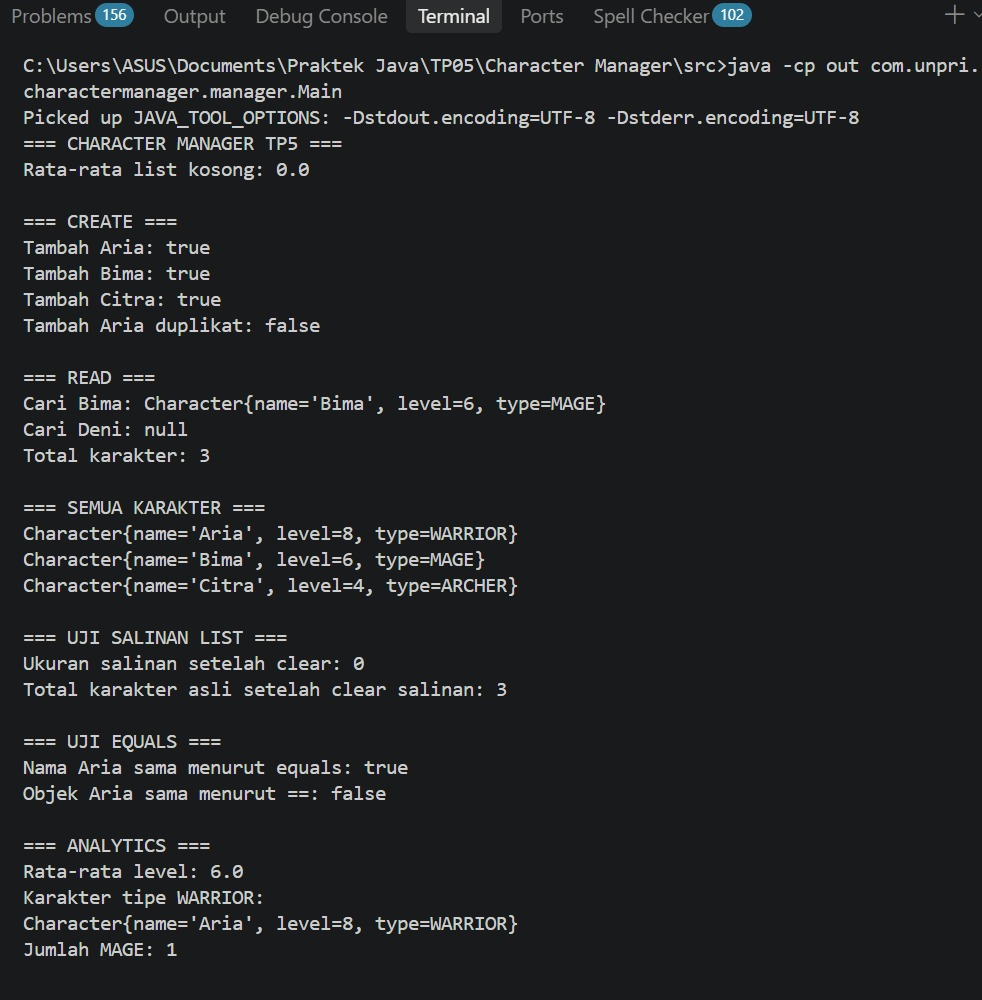
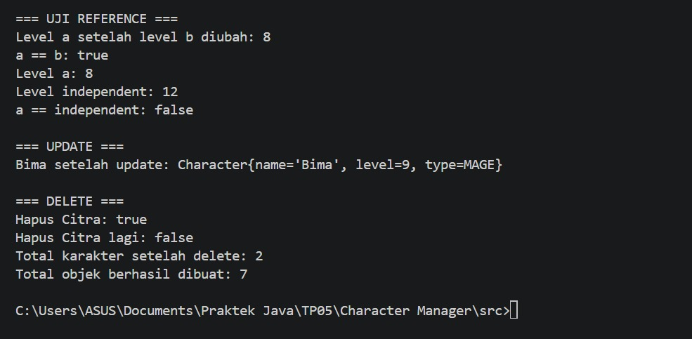
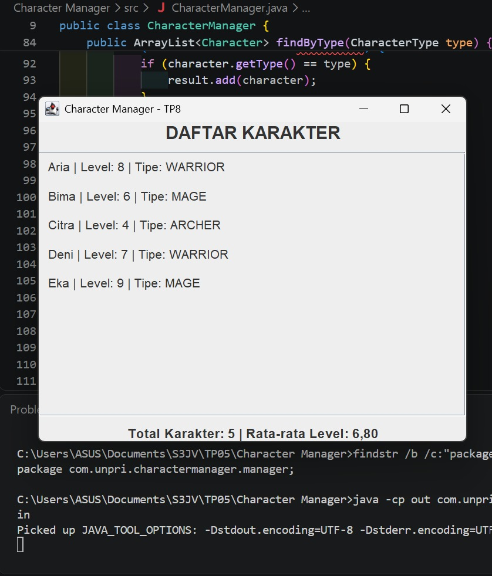
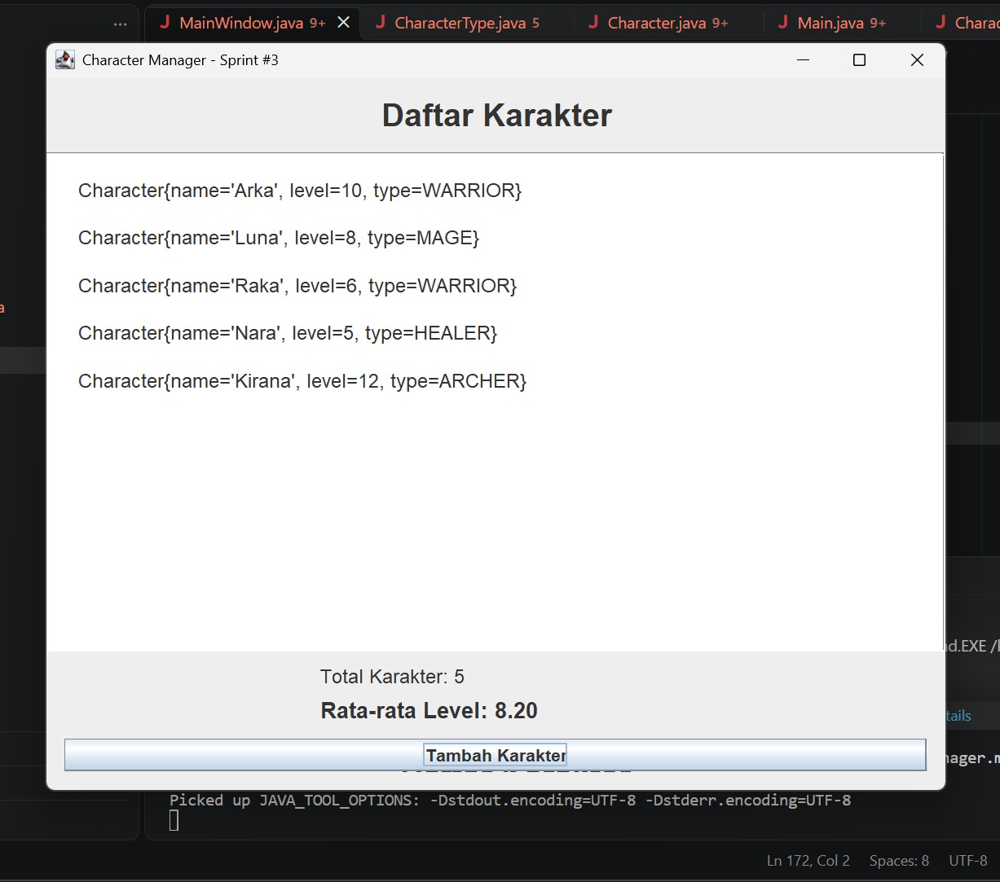

# CharacterManager

## TP5 — Character Manager Sprint #2

### 1. Deskripsi
Project ini mengimplementasikan pengelolaan karakter menggunakan Java.
Fitur meliputi penambahan, pencarian, penghapusan, analitik level,
pencarian berdasarkan tipe, dan pengujian reference.

### 2. Fitur Bagian A
- equals() membandingkan nama karakter.
- addCharacter() menolak nama duplikat.
- findByName() mencari karakter.
- removeCharacter() menghapus karakter.
- getTotalCharacters() menghitung data yang tersimpan.
- getAllCharacters() mengembalikan salinan ArrayList.

### 3. Fitur Bagian B
- getAverageLevel() menghitung rata-rata level.
- Mengembalikan 0.0 ketika daftar kosong.
- findByType() mencari semua karakter berdasarkan tipe.

### 4. Fitur Tambahan Bagian C
Fitur tambahan: countByType(CharacterType type).

Method ini menghitung jumlah karakter berdasarkan tipe yang dipilih.
Fitur ini membantu pengguna mengetahui jumlah karakter WARRIOR,
MAGE, atau ARCHER tanpa harus menghitungnya secara manual.

Method tidak mengembalikan ArrayList internal sehingga struktur
data karakter tetap terlindungi.

### 5. Pengujian

#### Output

#### Eksperimen Reference
Masukkan screenshot eksperimen a = b dan getAllCharacters() di sini.

### 6. Analisis Google Docs
Link Google Docs: [https://docs.google.com/document/d/1StKogg62ViMKlBcTAEO96wD5XwZnzVyQ7Y10SFtcomU/edit?usp=sharing]

### 7. Teknologi
- Java
- VS Code
<<<<<<< HEAD
- Git dan GitHub

## TP8 — MainWindow, Event-Driven Programming, dan MVC

### Implementasi MainWindow

Program Character Manager dikembangkan menggunakan Java Swing.
Kelas MainWindow berada di package view dan extends JFrame.
Data karakter ditampilkan secara dinamis menggunakan perulangan
for berdasarkan data dari CharacterManager.

### Screenshot Program

**Sebelum perubahan data — 3 karakter**

()

**Sesudah perubahan data — 5 karakter**

()

Statistik rata-rata level berubah dari 8,33 menjadi 8,60
setelah dua karakter baru ditambahkan.

### Aliran Data dan Prinsip MVC

Main.java membuat objek CharacterManager dan memasukkan data
karakter ke dalamnya. CharacterManager bertugas menyimpan dan
mengelola data karakter, termasuk menghitung rata-rata level.
MainWindow mengambil data melalui CharacterManager dan menampilkan
daftar karakter serta statistik dalam komponen JLabel.
Aliran ini menerapkan prinsip MVC karena model mengelola data,
view bertanggung jawab atas tampilan, dan pemisahan keduanya
membuat program lebih mudah dirawat.

### Karakter Baru

1. Luna — HEALER, level 6. Dipilih untuk melengkapi variasi
   peran karakter dengan kemampuan pendukung.
2. Ragnar — WARRIOR, level 12. Dipilih untuk menambah variasi
   level dan membandingkan karakter dengan level lebih tinggi.

### Dokumentasi Analisis TP8

[Google Docs — Analisis GUI dan MVC](https://docs.google.com/document/d/1f-ECuWz--cHbNq6ZMyi9WH1w2WBP8pyJzqAXe657lE8/edit?usp=sharing)
=======
- Git dan GitHub
>>>>>>> 1839b646989e05707c098950befb06f2ce90a90e
